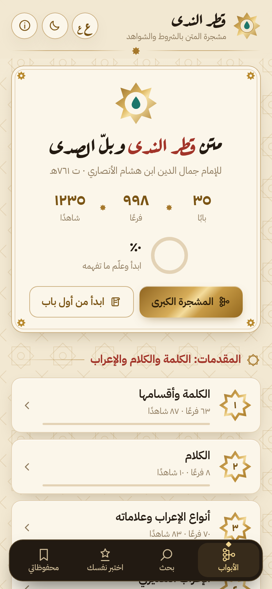
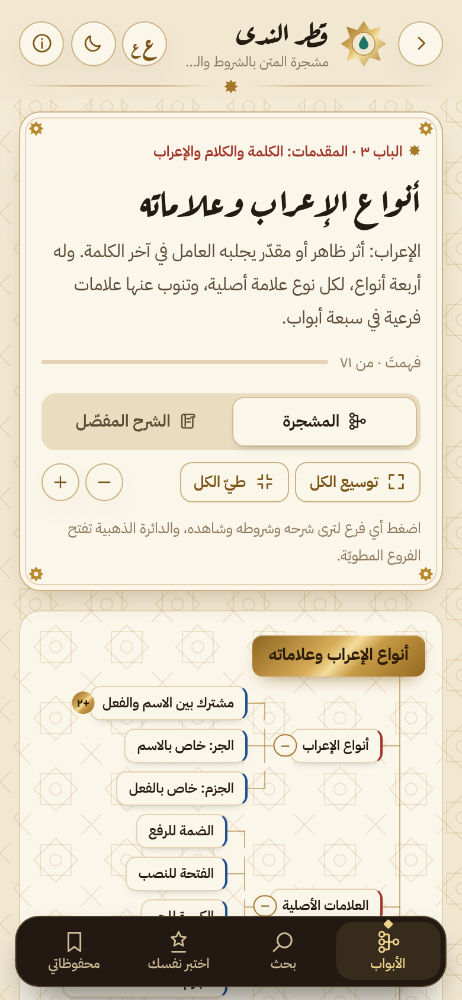
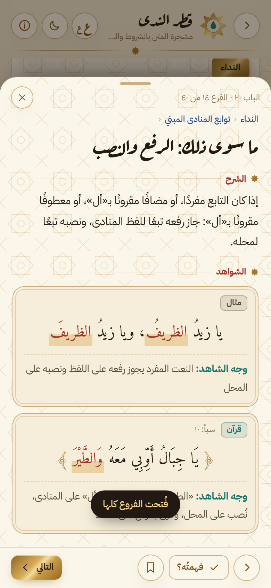
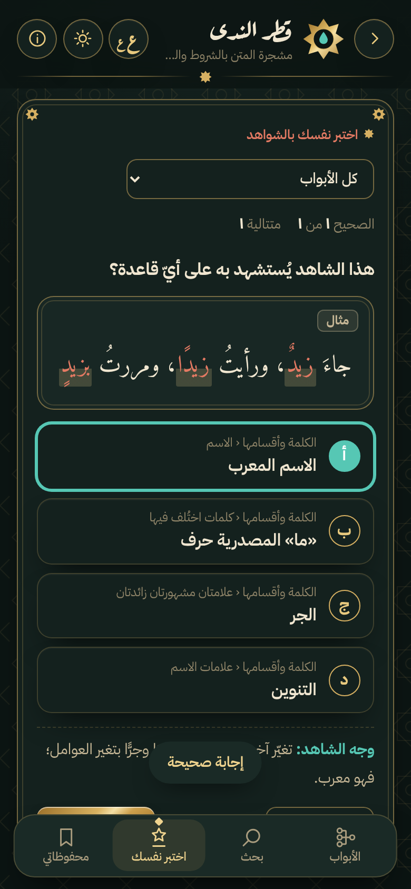
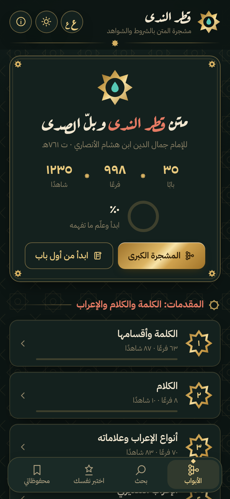

# مشجرة قطر الندى ✦

تطبيق أندرويد يعرض متن **«قطر الندى وبلّ الصدى»** لابن هشام الأنصاري على هيئة **مشجرة** مبسّطة،
بترتيب أبواب المتن، وتحت كل غصن: الشرح المبسّط، والشروط، والأحكام والقواعد، والشاهد (قرآن، حديث، شعر، أو مثال)
مع تظليل موضع الشاهد. التصميم بطراز **«المخطوطة المذهّبة»**: نقوش هندسية، وتذهيب، وعناوين بخط الرقعة، وحُمرة للعناوين الفرعية كما في المخطوطات، بوضعين: «الرَّقّ» (فاتح) و«حبر الليل» (داكن).

**المحتوى:** 35 بابًا بترتيب المتن، 998 غصنًا، 1235 شاهدًا.

**التحميل:** ملف التثبيت جاهز في [`dist/qatr-alnada-mushajjara-v1.1.apk`](dist/qatr-alnada-mushajjara-v1.1.apk) (أندرويد 8 فما فوق).

| الرئيسية | المشجرة | صفحة الفرع | اختبر نفسك | حبر الليل |
|---|---|---|---|---|
|  |  |  |  |  |

## المزايا
- **المشجرة الكبرى**: أبواب المتن كلها على شجرة واحدة، ثم مشجرة تفصيلية لكل باب (من اليمين إلى اليسار)، مع طيّ الفروع وفتحها.
- **نافذة الغصن**: الشرح، الشروط، الأحكام، الشواهد ووجه الاستشهاد، والتنبيهات، والتنقل بالتالي/السابق.
- **الشرح المفصّل**: قراءة الباب كاملًا متصلًا.
- **بحث** في المتن كله يتجاهل التشكيل.
- **اختبر نفسك**: يُعرض شاهد وتختار القاعدة التي يُستشهد به عليها.
- **تقدّمك**: علّم ما فهمته ✓ واحفظ المهم ☆ (يُحفظ على الجهاز).
- يعمل **بدون إنترنت**.

## بنية المشروع
```
web/              واجهة التطبيق (HTML/CSS/JS) — تُضمَّن كأصول في التطبيق
  data/part-*.js  محتوى المشجرة (باب لكل عقدة عليا)
app/              مشروع أندرويد (WebView)
tools/validate.js أداة التحقق من صحة ملفات المحتوى
```

## البناء
يتطلب JDK 17+ و Android SDK (platform 35).
```bash
node tools/validate.js          # التحقق من المحتوى
./gradlew assembleDebug         # نسخة تجريبية
./gradlew assembleRelease       # نسخة موقّعة (تحتاج keystore.properties)
```
ملف `keystore.properties` (غير مرفوع) يحوي: `storeFile`, `storePassword`, `keyAlias`, `keyPassword`.

## صيغة المحتوى
كل عقدة: `t` العنوان، `d` الشرح، `m` عبارة المتن، `c` الشروط، `r` الأحكام، `sh` الشواهد، `n` تنبيهات، `k` الفروع.
الشاهد: `x` النص، `h` موضع الشاهد (يُظلَّل)، `s` نوعه (`q` قرآن، `h` حديث، `p` شعر، `a` قول، `m` مثال)، `ref` المرجع، `w` وجه الاستشهاد.

## الرخص
الخطوط (Aref Ruqaa، IBM Plex Sans Arabic، Amiri) برخصة SIL Open Font License — النصوص في `web/fonts/`.
